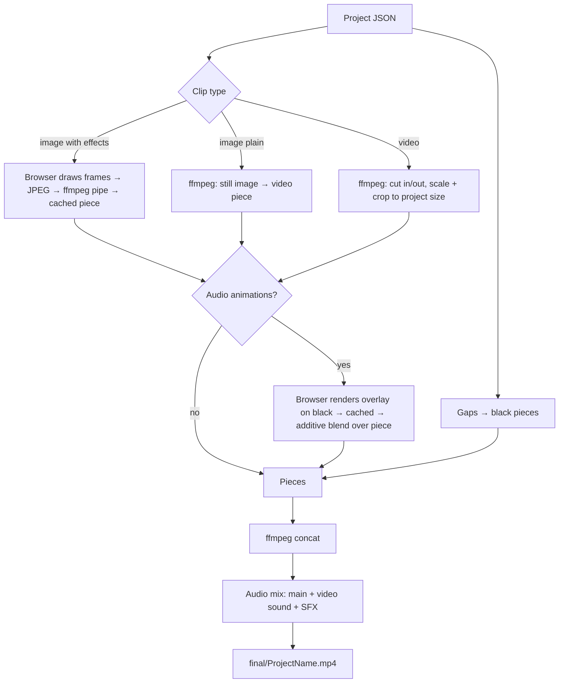

# Motion Editor

A browser-based, Kdenlive-style video editor for building **audio-driven story videos** from images and video clips. The whole app is a single Python file (standard library only) that serves a rich HTML/JavaScript editor on `localhost`.

You assemble a timeline from images and videos, add **cinematic image effects** (zooms, glows, light rays, parallax…), drop **audio-reactive animations** (such as a neural-swarm visualizer) on top of any clip, layer **sound effects** on unlimited tracks, and render everything to a single `.mp4` with the final audio mix.

> The editor UI is written in Hinglish (Hindi + English). Button names quoted in this document are exactly as they appear in the UI.

---

## Table of contents

1. [Features](#features)
2. [How it works (architecture)](#how-it-works-architecture)
3. [Requirements](#requirements)
4. [Installation](#installation)
   - [Windows](#windows-10--11)
   - [Ubuntu / Debian](#ubuntu--debian)
   - [macOS](#macos)
5. [Running the editor](#running-the-editor)
6. [Folder structure](#folder-structure)
7. [Quick start tutorial](#quick-start-tutorial)
8. [User interface guide](#user-interface-guide)
9. [Keyboard & mouse shortcuts](#keyboard--mouse-shortcuts)
10. [Image effects](#image-effects)
11. [Audio animations (audio visualizers)](#audio-animations-audio-visualizers)
12. [Audio: main track, video sound, SFX tracks](#audio-main-track-video-sound-sfx-tracks)
13. [Rendering](#rendering)
14. [Project file format](#project-file-format)
15. [Extending the editor](#extending-the-editor)
16. [HTTP API reference (internal)](#http-api-reference-internal)
17. [Troubleshooting](#troubleshooting)
18. [Known limitations](#known-limitations)
19. [Security notes](#security-notes)
20. [Roadmap ideas](#roadmap-ideas)
21. [License](#license)

---

## Features

**Timeline & editing**
- Drag images and videos from a folder-grouped media library onto a timeline.
- Trim clips from both edges, move, split, delete, ripple-delete, close gaps, snap to edges / playhead.
- Zoom, pan, fit-to-window; unlimited undo / redo (80 steps).
- Copy / paste / duplicate clips (with their effects and animations), SFX clips, and single effects.
- Project length is driven by a single **main audio** file; the last image can be stretched to the audio end.
- Autosave to a JSON project file; *Save As* to any name; open any saved project later.
- Timeline zoom, scroll position, playhead and selection are remembered across page reloads.

**Image effects (per image, multiple effects)**
- Every image has its own *FX lane*: stack as many effects as you like, each with its own start and length.
- Smooth cross-fade between effects; live preview while you pick effects.
- Effects live in plain JavaScript files (`motions.js`, `motions/*.js`) – easy to add and reorder with an `order` value.

**Audio animations (audio-reactive visualizers)**
- A separate **analysis audio** (e.g. the raw voice without sound effects) is analysed into `audio_data.npz` (peaks, RMS, ZCR, low/mid/high band energy, spectral centroid).
- Drag an animation onto any image **or** video clip (or straight onto the preview to choose its position).
- Position, size, start and length are editable; a ✛ handle on the preview lets you drag the animation.
- Animations are JavaScript classes, one file per animation in `audio_look/`.
- Deterministic and seek-safe: scrubbing anywhere reproduces the same frame.

**Sound**
- Main audio track (A1) with volume (dB) and mute.
- Video clips' own sound shown on a *Video awaaz* track with waveform, dB and mute.
- Any number of **SFX tracks**; each SFX clip has volume (dB), fade in / fade out, trim, mute, and can be moved between tracks.
- Everything plays in the preview (Web Audio, including positive-dB boost).
- Everything is mixed into the final render.

**Rendering**
- **Full video render** → `final/<ProjectName>.mp4` (video + main audio + video sound + all SFX).
- **Selected item render** → `motion/<start>_<end>.mp4` for the selected image *or* video clip.
- Rendered effect/animation pieces are cached and reused when nothing changed.

**Quality of life**
- Hover a library item for a large preview popup; click for a full-screen preview; click an audio file to listen.
- *Max view* full-screen playback with a small seek bar.
- Resizable layout (drag the panel edges); thumbnail size switch (1 / 2 / 3 columns).
- Browser codec fallback: unsupported video codecs are transparently proxied to H.264 for preview.

---

## How it works (architecture)

```
┌──────────────────────────── Browser (editor UI) ────────────────────────────┐
│  Timeline · Library · Preview canvas · FX lane · Audio mixer (Web Audio)    │
│  Effects (motions.js, motions/*.js)   Audio animations (audio_look/*.js)    │
└───────────────▲──────────────────────────────────────────────┬──────────────┘
                │ HTTP / JSON                                  │ JPEG frames
┌───────────────┴──────────────────────────────────────────────▼──────────────┐
│                     motion_editor.py  (Python, stdlib only)                  │
│  project JSON · file browser · thumbnails · waveform peaks · audio analysis  │
│  ffmpeg pipes · render jobs · final mix                                      │
└───────────────┬──────────────────────────────────────────────────────────────┘
                │ subprocess
        ┌───────▼────────┐        ┌───────────────┐
        │ ffmpeg/ffprobe │        │ numpy (audio  │
        └────────────────┘        │  analysis)    │
                                  └───────────────┘
```

Key design decisions:

- **Effects and animations are drawn with the browser's Canvas 2D API.** The same code produces the live preview and the rendered frames, so *what you see is what you render*.
- **Rendering effect pieces:** the browser draws each frame, encodes it as JPEG and streams it to `ffmpeg` (MJPEG → MPEG-4 piece). The tab must stay open during this step.
- **Final assembly is done by ffmpeg**: video clips are cut and scaled, still images become video, gaps become black, audio animations are blended additively over their clip, and all audio sources are mixed.
- **Everything is project-file driven.** No pre-generated data files are required; the project JSON is the single source of truth.

---

## Requirements

| Component | Version | Needed for |
|---|---|---|
| **Python** | 3.8 or newer (3.10+ recommended) | the server (`motion_editor.py`) |
| **ffmpeg + ffprobe** | any recent build (4.4+ recommended) with `libx264` and `aac` | thumbnails, proxies, waveforms, rendering |
| **numpy** | any recent version | audio analysis for **audio animations** only |
| **Web browser** | Chrome / Edge (recommended), Firefox | the editor UI |

Notes:
- No other Python packages are required – the server uses only the standard library.
- numpy is optional: without it everything works except audio animations (the UI will show a hint).
- Safari works but has no canvas `filter`, so glow blur uses a lighter fallback.
- ffmpeg 4.4 or newer is recommended (the audio mixer uses `amix … normalize=0`; older versions fall back automatically).

---

## Installation

### Windows 10 / 11

**1. Install Python**

1. Download the installer from <https://www.python.org/downloads/windows/>.
2. Run it and **tick “Add python.exe to PATH”** on the first screen, then click *Install Now*.
3. Open a new *Command Prompt* or *PowerShell* and verify:
   ```bat
   python --version
   ```
   (If `python` is not found, use the launcher: `py --version`.)

**2. Install ffmpeg** (choose one option)

- **Option A – winget (easiest):**
  ```powershell
  winget install --id Gyan.FFmpeg -e
  ```
  Close and re-open the terminal afterwards.
- **Option B – Chocolatey:**
  ```powershell
  choco install ffmpeg
  ```
- **Option C – manual:**
  1. Download a *release full* build from <https://www.gyan.dev/ffmpeg/builds/> and extract it to `C:\ffmpeg`.
  2. Open *Start → “Edit the system environment variables” → Environment Variables*.
  3. Select **Path** under *System variables* → *Edit* → *New* → add `C:\ffmpeg\bin` → OK.
  4. Open a **new** terminal.

Verify:
```bat
ffmpeg -version
ffprobe -version
```

**3. Install numpy** (needed for audio animations)
```bat
python -m pip install numpy
```

**4. Get the project**
```bat
git clone https://github.com/<your-user>/<your-repo>.git
cd <your-repo>
```
(or download the ZIP from GitHub and extract it).

**5. Run**
```bat
python motion_editor.py
```
Open <http://localhost:8000> in Chrome or Edge.

> **Tip (Windows):** media paths can be typed in the in-app file browser as `D:\videos\project` – both `\` and `/` work.

---

### Ubuntu / Debian

```bash
# 1. system packages
sudo apt update
sudo apt install -y python3 python3-venv python3-pip ffmpeg git

# 2. get the project
git clone https://github.com/<your-user>/<your-repo>.git
cd <your-repo>

# 3. (recommended) virtual environment + numpy
python3 -m venv .venv
source .venv/bin/activate
pip install numpy

# 4. run
python3 motion_editor.py
```

Open <http://localhost:8000>.

Alternative without a virtual environment (Ubuntu 23.04+ blocks system-wide `pip install`):
```bash
sudo apt install -y python3-numpy
python3 motion_editor.py
```

Verify the tools:
```bash
python3 --version
ffmpeg -version | head -n 1
ffprobe -version | head -n 1
python3 -c "import numpy; print(numpy.__version__)"
```

If media lives on an NTFS / Windows drive (dual boot), make sure the drive is mounted and readable by your user, e.g. `/media/<user>/Windows/video/...`.

---

### macOS

```bash
brew install python ffmpeg
python3 -m pip install numpy
python3 motion_editor.py
```

---

## Running the editor

```bash
python motion_editor.py                    # http://localhost:8000, project: editor_motion.json
python motion_editor.py 9000               # custom port
python motion_editor.py my_story.json      # open / create another project file
python motion_editor.py 9000 my_story.json
```

- The server listens on **127.0.0.1 only** (not reachable from other machines). To use it from another device on your network, change `"127.0.0.1"` to `"0.0.0.0"` in the last line of `motion_editor.py` – see [Security notes](#security-notes) first.
- Stop the server with `Ctrl + C`.
- Keep the browser tab open while a render is running (effect frames are drawn in the browser).

---

## Folder structure

```
your-repo/
├── motion_editor.py          # server + editor UI (single file)
├── motions.js                # classic image-effects file (auto-created with 3 demo effects)
├── motion_kit.js             # helper functions for writing new effects (window.MKIT)
├── motions/                  # drop extra effect files here (*.js)
│   └── v01_parallax.js
├── audio_animations.js       # common kit for audio animations (window.AUDIO_KIT)
├── audio_look/               # one audio animation per file (*.js)
│   └── CyberneticNeuralSwarm.js
└── editor_motion.json        # default project file (created on first run)
```

Files and folders **generated at runtime** (safe to delete; add them to `.gitignore`):

| Path | Content |
|---|---|
| `*.json` (project files) | your projects (`editor_motion.json`, `my_story.json`, …) |
| `audio_data.npz` | features of the current analysis audio |
| `audio_data_backup.npz` | one-time backup of a pre-existing `audio_data.npz` |
| `motion/` | rendered pieces: `<start>_<end>.mp4` (selected-item renders) and `_cache/` (reusable pieces) |
| `final/` | final videos: `<ProjectName>.mp4` |
| `animate_data_new.py` | optional export in the legacy `data_x` format |
| `.thumbs/` | thumbnail cache |
| `.proxy_cache/` | H.264 preview proxies for unsupported codecs |
| `.cache/` | waveform peaks and analysis cache |
| `.render_tmp/` | temporary files during the final render |

Suggested `.gitignore`:
```gitignore
.thumbs/
.proxy_cache/
.cache/
.render_tmp/
motion/
final/
audio_data.npz
audio_data_backup.npz
animate_data_new.py
__pycache__/
.venv/
```

---

## Quick start tutorial

1. **Start the editor** and open <http://localhost:8000>. A blank project (`editor_motion.json`) is created.
2. **Import media:** click **＋ Import**, navigate to your folders. Tick the checkbox next to a folder to import everything in it (tick *subfolders bhi* to include sub-directories), or tick individual files. Images, videos and audio are all supported. The library groups items **folder-wise**.
3. **Choose the main audio:** click **🔊 Main audio** (or drag an audio item onto the **A1** row). Its length defines the video length.
4. **Build the timeline:** drag images / videos from the library onto the **V1** row. Double-click a library item to append it. Drag a whole **folder header** onto the timeline to place all its clips one after another.
5. **Trim and arrange:** drag clip edges to trim, drag clips to move (they snap to neighbours and the playhead). Press `S` to split at the playhead.
6. **Add image effects:** select an image clip, pick an effect in the right panel (**🖼 Image effects**) – it previews from the playhead. Click **Effect lagao** (or double-click the effect) to place it. Adjust it in the **FX lane**.
7. **Add an audio animation:** open **🎧 Audio animations**, click **🎙 Analysis audio chuno** and select the raw voice file (analysis runs once and is cached). Drag an animation onto a clip or directly onto the preview where you want it.
8. **Add sound effects:** drag an audio item onto an SFX row (a track is created automatically) or press **＋ SFX track**. Select an SFX clip to set dB, fades, mute.
9. **Preview:** press `Space`. Use **⛶ Max view** for full screen.
10. **Render:** **🎬 Full video render** → `final/<ProjectName>.mp4`.

---

## User interface guide

### Top bar
| Control | Purpose |
|---|---|
| project name | current project and its file |
| **New / Open / Save / Save As** | project management (autosave is always on) |
| **⚙** | project settings (name, resolution, FPS, fade, default image length, root folder) |
| **▶ Play**, time | play / pause, current time / total |
| **⛶ Max view** | full-screen preview (`M`) |
| **🎬 Full video render** | render the whole project |
| **💾 Selected item render** | render only the selected image / video clip |
| **purane render reuse** | reuse cached pieces when nothing changed |
| **→ animate_data_new.py** | export the timeline in the legacy `data_x` format |

### Left panel – media library
- **＋ Import** opens the file browser. Folder checkboxes import whole folders; audio files are included.
- **🔊 Main audio** selects the main audio. The name and length are shown on one line.
- Tabs filter All / Image / Video / Audio; `▢ ▦ ▩` change the thumbnail size; the search box filters by name.
- Items are grouped by **folder** (click a header to collapse; ✕ removes the folder from the library; drag the header to add all its clips).
- **Hover** an item → large preview popup. **Click** → full-screen preview (✕ Close / `Esc`). **Click an audio item** → plays it (click again to stop). **Double-click** → add to the timeline (audio becomes an SFX at the playhead).

### Centre – preview
- The canvas shows exactly what will be rendered. A thin info bar below shows the clip and the active effects / animations (it never overlays the video).
- Drop an **effect** here to apply it from the playhead; drop an **audio animation** here to place it at the drop position.
- The green **✛ handle** moves the selected audio animation.
- Drag the thin handles on the left / right / bottom edges of this area to resize the library, the right panel and the timeline height (saved in the browser).

### Right panel
- **🖼 Image effects** – effect list (ordered by `order`), search, *Effect lagao*, *reload*.
- **🎧 Audio animations** – analysis-audio chooser with status, animation list.
- **Clip properties** – start, length, in-point; **audio properties** for the selected SFX clip or video clip (volume dB, fades, mute …).

### FX lane (between preview and timeline)
Shows the effects of the selected **image** (tab *Image effects*) or the audio animations of the selected **clip** (tab *Audio animations*). Drag to move, drag edges to resize, double-click empty space to add the picked item, `Delete` removes. Numeric fields allow precise values (including animation X / Y / Size).

### Timeline
| Row | Content |
|---|---|
| ruler | click / drag to move the playhead |
| **V1** | images and videos |
| **🎞 Video awaaz** | the sound of video clips (waveform, dB slider, mute) |
| **A1 · main** | main audio (waveform, dB slider, mute) |
| **SFX 1…n** | sound-effect tracks (each with name, mute, dB slider, delete ✕) |

Toolbar: **✂ Split, 🗑 Delete, ⇥ Ripple delete, Gaps band karo, ⤓ Last image → audio end, ⎘ Copy, ⎗ Paste, ⧉ Duplicate, ＋ SFX track, ↶ ↷, 🧲 Snap, − ＋, Fit**.

---

## Keyboard & mouse shortcuts

| Key | Action |
|---|---|
| `Space` | play / pause |
| `S` | split selected clip / SFX at the playhead |
| `Delete` | delete selected effect / SFX / clip |
| `Shift + Delete` | ripple delete (close the gap) |
| `Ctrl + C` / `Ctrl + V` | copy / paste at the playhead (clip, SFX, or a single effect / animation) |
| `Ctrl + D` | duplicate right after the selection |
| `Ctrl + Z` / `Ctrl + Shift + Z` (or `Ctrl + Y`) | undo / redo |
| `Ctrl + S` | save now |
| `← / →` | previous / next frame |
| `Shift + ← / →` | −1 s / +1 s |
| `↑ / ↓` | jump to previous / next clip edge |
| `Home` / `End` | start / end |
| `F` | fit the timeline |
| `M` | Max view (full screen) |
| `Esc` | close dialogs / full-screen preview / cancel effect preview |
| Mouse wheel on timeline | zoom around the cursor |
| `Shift + wheel` | pan horizontally |
| `Alt + wheel` | scroll the track rows |
| Middle-mouse drag | pan |

---

## Image effects

Effects only apply to **image** clips. Each image has an *FX lane*; an effect has a start and a length **inside the clip**. Where effects touch, they cross-fade (default 0.35 s, changeable in the lane header).

### Effect object format

```javascript
{key:'001', name:'Zoom Out Reveal', tag:'reveal / bada scene', order:1, draw(c,img,p,t,W,H){
  MX.cover(c,img,W,H,{z:1.3-.25*MX.oc(p)});
  MX.flash(c,W,H,'#fff',.5*Math.exp(-t*3));
  MX.vig(c,W,H,'rgba(0,0,0,.9)',.3)
}}
```

| Field | Meaning |
|---|---|
| `key` | unique id stored in the project |
| `name`, `tag` | shown in the list / searchable |
| `order` | *(optional)* position in the list: **smaller = higher** (1, then 2, then 3…). Effects without `order` come last, in load order. |
| `draw(c,img,p,t,W,H)` | `c` 2D context · `img` the image · `p` effect progress 0…1 · `t` seconds since the effect started · `W,H` canvas size |

Built-in helpers (`MX`): `cover, vig, flash, glow, bolt, path, clamp, lerp, oc (ease-out), io (ease-in-out), rng (seeded random)`.

### Where effects live

1. `motions.js` – classic file: `window.MOTIONS = [ {…}, {…} ];`
2. `motions/*.js` – any number of extra files, loaded automatically (alphabetically, natural order). Prefix a file name with `_` to disable it.
3. `motion_kit.js` – optional helper set (`window.MKIT`) so new files don't need to copy helper code.

Example `motions/my_effects.js` using the old object format:

```javascript
(function(){
const {add}=MKIT;
add([
  {key:'002', name:'Slow Zoom In', tag:'calm', order:2, draw(c,img,p,t,W,H){
    MX.cover(c,img,W,H,{z:1+.14*p}); MX.vig(c,W,H,'rgba(0,0,0,.9)',.35)}},
]);
})();
```

Using the compact helper form (`M(key,name,tag,draw,order)`):

```javascript
(function(){
const {S,cov,mask,tealOrange,vg,M,add}=MKIT;
add([
  M('v1','Parallax Depth of Field','portrait / depth',(c,im,p,t,W,H)=>{
    /* …drawing code… */
  }, 1),            // ← last number = order
]);
})();
```

`add(list, startOrder)` can also number a whole list automatically (`add([...], 100)` → 100, 101, 102…). If two files define the same `key`, the one loaded last replaces the earlier (editor shows a warning for duplicates created without `add`).

Changing an effect's code automatically invalidates its cached render.

---

## Audio animations (audio visualizers)

### Workflow
1. Open **🎧 Audio animations** (right panel).
2. Click **🎙 Analysis audio chuno** and select the audio that should drive the visuals. Typically this is the **raw voice track without sound effects**. It must start at the same moment as the main audio (timeline `t = 0`).
3. The server analyses it once (chunked, so one-hour files are fine) and writes `audio_data.npz`. Results are cached per file.
4. Drag an animation onto a clip, or onto the preview at the desired position.

### Features stored in `audio_data.npz`

| Key | Meaning |
|---|---|
| `sampleRate`, `blockSize` (2048), `peaksPerSecond`, `totalBlocks` | analysis meta data |
| `peaks` | max absolute amplitude per block |
| `rms` | RMS energy per block |
| `zcr` | zero-crossing rate |
| `lows` / `mids` / `highs` | FFT energy below 250 Hz / 250–4000 Hz / above 4000 Hz |
| `spectralCentroid` | spectral centroid (Hz) |
| `audioPath`, `audioMtime` | which audio this file belongs to |

If the project's analysis audio differs from the one in `audio_data.npz`, it is re-analysed (or restored from cache) automatically.

### Animation item fields (`clip.vis[]`)

`{ id, key, start, dur, x, y, scale }` – `start` is relative to the clip start, `x, y` are project pixels, `scale` multiplies size. Items can overlap, run on image **and** video clips, and are trimmed / split together with their clip.

### Writing a new animation

Create `audio_look/MyAnimation.js`:

```javascript
(function () {
  'use strict';
  const { FPS, RNG, clamp, lerpC, scaleC, css, seg, dot, ring, register } = window.AUDIO_KIT;

  class MyAnimation {
    constructor({ audio, t0, dur }) {
      // audio = { pps, peaks[], rms[], zcr[], lows[], mids[], highs[], centroid[] }  (may be null!)
      // t0  = absolute start on the timeline (s) → audio index = t0 * pps
      // dur = length (s)
      this.total = Math.max(1, Math.round(dur * FPS));
    }
    render(ctx, T, x, y, scale) {
      // T = seconds since the animation started, (x,y) = anchor in project pixels
      // draw with ctx.globalCompositeOperation = 'lighter' semantics (additive)
    }
  }

  register({ key: 'my_animation', py: 0, order: 5, name: 'My Animation', tag: 'description',
             defaults: { x: 640, y: 360, scale: 1 }, cls: MyAnimation });
})();
```

Guidelines:
- Keep the simulation in **local coordinates** around `(0,0)` and place it at `(x, y)` when drawing – that is what makes the position dynamic.
- Make frames **deterministic**: use the seedable `RNG`, step the simulation at 25 FPS, and keep periodic checkpoints (see `CyberneticNeuralSwarm.js`) so seeking and rendering reproduce identical frames.
- Always guard against `audio === null` (shown before the analysis finishes).
- The whole class source is part of the render cache key; editing it invalidates old renders for that animation only.
- Prefix the file name with `_` to disable it. Errors in one file never stop the others (a toast and console message name the file).

Bundled: **Cybernetic Neural Swarm** (`order: 1`).

---

## Audio: main track, video sound, SFX tracks

| Source | Where | Controls |
|---|---|---|
| **Main audio** | row **A1** | dB slider, mute |
| **Video clips' own sound** | row **🎞 Video awaaz** | row-level dB + mute; per-clip *Vol (dB)* and *Mute* in the right panel |
| **Sound effects** | rows **SFX 1…n** | track-level dB + mute; per-clip volume (dB), fade in, fade out, start, length, in-point, mute |

- **Main audio:** drop an audio library item on the **A1** row, or use **🔊 Main audio**. Replacing it keeps the dB / mute settings.
- **SFX:** drop an audio item on an SFX row. Dropping below the last row creates a new track. Double-clicking an audio item in the library adds it at the playhead. SFX clips can be dragged (also to another track), trimmed, split with `S`, copied and duplicated.
- **Preview:** all tracks play together; gain = clip dB + track dB, with fades applied. Positive dB (boost) works in the preview.
- **Render:** the same settings are applied by ffmpeg (`volume`, `afade`, `adelay`, `amix`).
- Waveforms are computed on the server (`/api/peaks`) and cached.

---

## Rendering

### Full video render (`🎬`)



Details:
- Resolution and FPS come from **⚙ settings** (default 1280×720 @ 25 fps).
- Images and videos are scaled with “cover” (fill and crop to the frame).
- Pieces are encoded with `libx264` (CRF 18, `veryfast`), audio with AAC 192 kbit/s.
- Animation overlays are blended with ffmpeg's `blend=all_mode=addition` in planar RGB, which matches the additive look of the preview.
- The audio mix uses `aformat` → `volume` → `afade` → `adelay` for every source and `amix` to combine them. SFX beyond the end of the video extend the video with black frames.
- Cached effect pieces live in `motion/_cache/`; keys are hashes of the clip, its effects / animations, the effect source code, the analysis audio and the resolution. Untick **purane render reuse** to force a re-render.
- **Cancel:** click the button again while rendering.

### Selected item render (`💾`)
- **Image clip:** image + effects + audio animations → `motion/<start>_<end>.mp4` (silent).
- **Video clip:** the trimmed clip scaled to the project size, with audio animations blended on top and the video's own sound (with its dB / mute) → `motion/<start>_<end>.mp4`.

---

## Project file format

Projects are plain JSON (`editor_motion.json` by default). Simplified:

```jsonc
{
  "editor": "motion_editor", "version": 1, "name": "My Story",
  "settings": { "width": 1280, "height": 720, "fps": 25, "fade": 0.35, "image_len": 5.0, "root_folder": "/home/me" },
  "audio":     { "path": "/media/voice_mix.wav", "name": "voice_mix.wav", "duration": 3612.4, "vol": 0, "mute": false },
  "vis_audio": { "path": "/media/voice_raw.wav", "name": "voice_raw.wav", "duration": 3612.4 },
  "media": [ { "path": "/media/img/a.png", "type": "image", "name": "a.png", "duration": 0 } ],
  "clips": [
    {
      "id": "c1a2b3", "name": "a.png", "resource": "/media/img/a.png", "type": "image",
      "start": 0.0, "end": 12.0, "duration": 12.0, "output": "0_12", "in": 0, "out": 12.0,
      "motion": "001",
      "effects": [ { "key": "001", "start": 0.0, "dur": 12.0 } ],
      "vis": [ { "id": "vx1", "key": "neural_swarm", "start": 0.0, "dur": 12.0, "x": 185, "y": 555, "scale": 1 } ]
    },
    {
      "id": "c4d5e6", "name": "clip.mp4", "resource": "/media/clip.mp4", "type": "video",
      "start": 12.0, "end": 20.0, "duration": 8.0, "in": 3.0, "out": 11.0, "src_duration": 30.0,
      "vol_db": -2, "amute": false
    }
  ],
  "vtrack": { "mute": false, "vol": 0 },
  "atracks": [ { "id": "t9", "name": "SFX 1", "mute": false, "vol": -3 } ],
  "aclips": [
    { "id": "s1", "track": "t9", "resource": "/media/sfx/boom.wav", "name": "boom.wav",
      "start": 5.5, "duration": 2.0, "in": 0.2, "src_duration": 3.0, "vol": 3, "fi": 0.1, "fo": 0.4, "mute": false }
  ],
  "view": { "scale": 12.5, "vs": 0, "time": 4.2, "sel": "c1a2b3" }
}
```

Notes:
- All times are **seconds on the project timeline** (effects / animations are relative to their clip).
- `animate_data.json` / `animate_data.py` (legacy `data_x` list) can be imported from **Open → Import**, and the timeline can be exported with **→ animate_data_new.py**.
- Media paths are stored as absolute paths. Moving files requires re-importing or editing the JSON.

---

## Extending the editor

| Goal | How |
|---|---|
| Add an image effect | add an object to `motions.js` or create `motions/<name>.js` |
| Change list order | set `order` (smaller = higher) |
| Add an audio animation | create `audio_look/<Name>.js` calling `AUDIO_KIT.register({...})` |
| Disable a file temporarily | rename it with a leading `_` |
| Share effect helpers | add to `motion_kit.js` (`window.MKIT`) / `audio_animations.js` (`window.AUDIO_KIT`) |
| Change resolution / FPS | **⚙** settings |
| Change the port | `python motion_editor.py <port>` |

Reload the browser page after editing JavaScript files – the server reads them on every request.

---

## HTTP API reference (internal)

The UI talks to the server through these endpoints (useful for debugging or automation).

| Method & path | Purpose |
|---|---|
| `GET /` | the editor page |
| `GET /api/init` | root folder, current project, tool availability (`ffmpeg`, `numpy`) |
| `POST /api/save` `{project, as?}` | save (optionally *Save As*) |
| `GET /api/projects`, `POST /api/open`, `POST /api/new`, `POST /api/import_old` | project management |
| `GET /api/ls`, `GET /api/scan` | file browser / folder scan (images, videos, audio) |
| `GET /api/probe?p=` | duration (ffprobe) |
| `GET /api/peaks?p=` | waveform peaks (adaptive resolution, cached) |
| `GET /file?p=`, `GET /thumb?p=`, `GET /proxy?p=`, `GET /api/proxy?p=` | media streaming (range requests), thumbnails, H.264 preview proxy |
| `POST /api/vis_ensure`, `GET /api/vis_status`, `GET /api/vis_data` | audio analysis → `audio_data.npz` |
| `GET /motions.js`, `/motion_kit.js`, `/audio_animations.js`, `/api/motions_list`, `/api/audio_look`, `/motions/<f>`, `/audio_look/<f>` | effect and animation scripts |
| `POST /api/render_start`, `/api/render_frame`, `/api/render_end`, `/api/render_cancel` | browser-drawn frames → ffmpeg pipe |
| `POST /api/render_final`, `GET /api/final_status`, `POST /api/final_cancel` | full render job |
| `POST /api/render_clip`, `GET /api/clip_status` | selected video clip render job |
| `POST /api/exists` | which cached pieces already exist |
| `POST /api/export` | legacy `animate_data_new.py` export |

---

## Troubleshooting

| Problem | Likely cause / fix |
|---|---|
| Toast: *ffmpeg / ffprobe PATH me nahi mila* | install ffmpeg and make sure `ffmpeg -version` works in the same terminal that starts the server; restart the terminal after changing PATH |
| *numpy install nahi hai* in the audio-animation tab | `python -m pip install numpy` (use the same Python that runs the server) |
| Thumbnails are blank | ffmpeg missing, or the file is unreadable; check the terminal output |
| A video does not play in the preview | the codec is not supported by the browser – the editor builds an H.264 proxy automatically (needs ffmpeg); wait a few seconds |
| No sound in the preview | click **Play** once (browsers start audio only after a user gesture); check the mute buttons and dB sliders; the main audio must be a browser-playable format |
| Audio animation is static | the analysis audio is not selected or still analysing (status shown in the tab); the animation idles without data |
| Audio animation does not match the speech | the analysis audio must start at the same time as the main audio |
| Render fails with an ffmpeg message | read the toast; make sure ffmpeg has `libx264` and `aac`; very old ffmpeg versions lack some filters |
| Render is slow | effect frames are rendered in the browser (about one JPEG per frame) – keep the tab visible; re-use caches; lower the resolution / FPS in **⚙** |
| Final video missing some SFX | check track / clip mute, and that the files still exist at their stored paths |
| `Address already in use` | another process uses the port: `python motion_editor.py 9001` |
| Layout looks cramped | drag the panel edges in the centre area; use the thumbnail-size buttons; zoom the browser (`Ctrl + −`) |
| Safari: glow looks softer | Safari has no canvas `filter`; a lighter fallback is used |

---

## Known limitations

- The tab must stay open during the browser-rendered part of a render.
- Only one main audio file and one analysis audio file per project.
- No transitions between clips (effects can cross-fade inside an image clip).
- Videos and images are always scaled with “cover” (cropped), never letter-boxed.
- Very large SFX counts (hundreds of clips) produce very long ffmpeg filter graphs; for extreme cases split the project.
- SFX clips on the same track may overlap visually; use another track to keep them apart.
- Audio animation preview of one-hour items needs a one-time simulation on first seek (checkpoints make later seeks fast).
- The editor has been developed for local, single-user use.

---

## Security notes

- The server binds to `127.0.0.1`. The `/file` endpoint streams **any file path the server process can read**. **Do not expose this server to untrusted networks** (do not bind to `0.0.0.0` on public Wi-Fi, do not port-forward it).
- Project files contain absolute local paths; avoid committing personal projects to a public repository.

---

## Roadmap ideas

- Port more audio animations from existing Python implementations (one file per animation in `audio_look/`).
- 3D / perspective transforms for audio animations.
- Offset control between main audio and analysis audio.
- Clip transitions and speed changes.
- Export presets (resolution, bitrate) and background rendering queue.

---

## License

MIT License

Copyright (c) 2026 nandu-deshmukh

Permission is hereby granted, free of charge, to any person obtaining a copy
of this software and associated documentation files (the "Software"), to deal
in the Software without restriction, including without limitation the rights
to use, copy, modify, merge, publish, distribute, sublicense, and/or sell
copies of the Software, and to permit persons to whom the Software is
furnished to do so, subject to the following conditions:

The above copyright notice and this permission notice shall be included in all
copies or substantial portions of the Software.

THE SOFTWARE IS PROVIDED "AS IS", WITHOUT WARRANTY OF ANY KIND, EXPRESS OR
IMPLIED, INCLUDING BUT NOT LIMITED TO THE WARRANTIES OF MERCHANTABILITY,
FITNESS FOR A PARTICULAR PURPOSE AND NONINFRINGEMENT. IN NO EVENT SHALL THE
AUTHORS OR COPYRIGHT HOLDERS BE LIABLE FOR ANY CLAIM, DAMAGES OR OTHER
LIABILITY, WHETHER IN AN ACTION OF CONTRACT, TORT OR OTHERWISE, ARISING FROM,
OUT OF OR IN CONNECTION WITH THE SOFTWARE OR THE USE OR OTHER DEALINGS IN THE
SOFTWARE.
